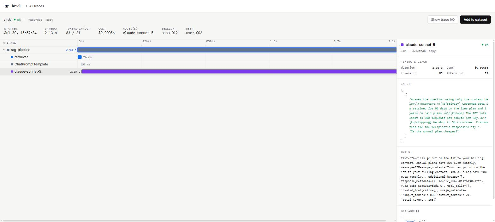
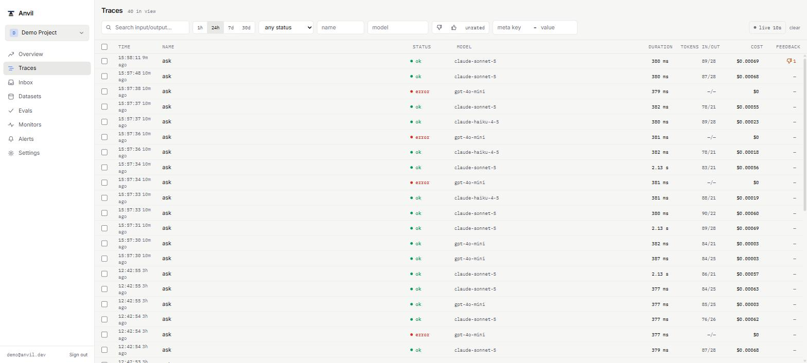
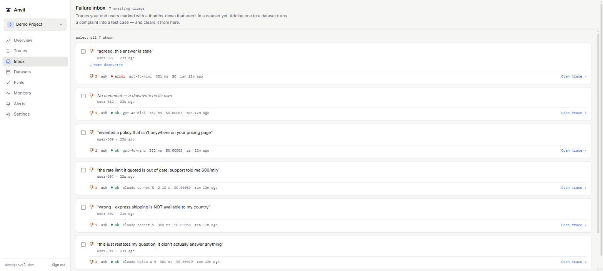
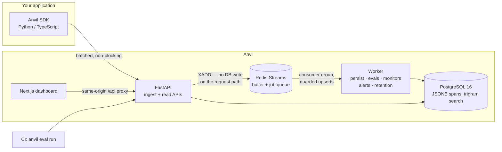

# Anvil

**Observability and evaluation for the LLM features in your product.** Trace every
AI request, promote the ones that went wrong into datasets, score prompt changes
against them, and gate a pull request on the result.

[](LICENSE)


Self-hosted, MIT-licensed, and complete. There is no paid tier, no quota, and no
hosted version to upsell — `docker compose up` gives you the whole product
([ADR-0019](plan/adr/0019-fully-open-source-no-commercial-tiers.md)).



---

## Why

Shipping an LLM feature, you hit the same three problems in order:

1. **It broke and you cannot see why.** The output is wrong but the failure is
   somewhere in a chain — retrieval returned the wrong chunk, the prompt template
   dropped a variable, the model got the context and ignored it. Logs give you the
   input and the output, and nothing in between.
2. **You changed the prompt and you do not know if it helped.** You try five
   examples by hand, it looks better, you ship. Two weeks later something else is
   worse.
3. **Your users know about failures you don't.** Somebody got a wrong answer in
   March and told nobody, and that exact case is in none of your tests.

Anvil is built around the loop those three imply: **trace → complaint → dataset →
score → gate**, with the test suite growing out of observed failures rather than
imagination.

## Install

```bash
git clone https://github.com/nishanroy561/Anvil && cd Anvil
cp .env.example .env
docker compose up -d --build --wait
docker compose exec api python -m anvil_api.seed     # prints an API key, once
```

<http://localhost:3000> — sign in with `demo@anvil.dev` / `demo1234`.

`--wait` returns when every container is *healthy*, not merely started. Migrations
run as a one-shot service before the API comes up.

**Next: [`DEMO.md`](DEMO.md) is a five-minute walkthrough** taking a user complaint
all the way to a CI gate. It is worth the five minutes; the rest of this page is
reference.

## Instrument your app

Python:

```python
import anvil_sdk as anvil
anvil.init(api_key="ak_…")

@anvil.observe(type="llm")
def answer(question: str) -> str:
    ...
```

Or with LangChain, where the whole integration is one callback:

```python
from anvil_sdk.langchain import AnvilCallbackHandler

handler = AnvilCallbackHandler(trace_name="ask", user_ref=user.id)
result = chain.invoke(question, config={"callbacks": [handler]})
return {"answer": result, "trace_id": handler.trace.id}
```

TypeScript:

```ts
import * as anvil from "@anvil/sdk";
anvil.init({ apiKey: "ak_…" });

await anvil.trace("ask", { input: question }, async (t) => {
  const docs = await anvil.span("retrieve", { type: "retrieval" }, () => search(question));
  t.output = await anvil.span("generate", { type: "llm" }, () => llm(docs));
});
```

Round-trip that `trace_id` to your frontend, and when a user rejects an answer:

```python
anvil.feedback(trace_id, -1, comment="it said 5 days, took three weeks", user_ref=user.id)
```

**The SDK never blocks or crashes your app**
([ADR-0013](plan/adr/0013-sdk-never-blocks.md)). Traces go to a bounded
in-memory queue shipped in the background; if Anvil is slow, down, or
misconfigured, the queue sheds its oldest entries, counts them in `anvil.stats()`,
and your request path never notices. Killing Anvil mid-request is part of the test
suite.

## What you get

| | |
|---|---|
| **Traces** | Full execution tree per request: retrieval chunks, prompt template and variables, model, tokens, per-step latency, computed cost |
| **Failure inbox** | Thumbs-down traces not yet in a dataset — a triage queue that drains as you promote |
| **Datasets** | Promote real traces; items copy their payloads, so they outlive retention |
| **Graders** | 6 deterministic + 4 LLM judges, or [write your own](PLUGINS.md) |
| **Comparison** | Paired bootstrap and exact McNemar — and it says *inconclusive* when it is |
| **CI gate** | `anvil eval run`, with exit codes a workflow can branch on |
| **Monitors** | Score live traffic on a schedule; alert on drift, cost, latency |
| **Self-observability** | Prometheus, Grafana, and Anvil's own requests traced into Tempo |





## Architecture



The shape that matters: **ingest never writes to Postgres on the request path.** A
trace is durable once it is in a Redis Stream, which is what lets ingestion absorb
bursts far above database write throughput. The worker owns Postgres and consumes
through a consumer group, so a second replica needs no coordination and a worker
dying mid-batch costs latency rather than data
([ADR-0002](plan/adr/0002-redis-streams-for-buffer-and-jobs.md)).

Delivery is at-least-once, so duplicates are made *harmless* rather than prevented:
guarded upserts with a tenant guard and a monotonic completion guard, a reclaim path
for a dead consumer's pending entries, and a dead-letter queue after five failed
deliveries.

At 50k traces every dashboard read lands in 14–33 ms against a 500 ms budget, keyset
pagination is flat to page 12, and free-text search reaches the trigram index rather
than scanning — verified with `EXPLAIN`, because a sequential scan over 50k rows
passes a stopwatch and dies at five million. See `scripts/loadtest_reads.py`.

## Deployment

```bash
export SECRET_KEY=$(openssl rand -hex 32)
docker compose -f docker-compose.yml -f docker-compose.prod.yml up -d --build --wait
```

Non-root containers, healthchecks on every service, two worker replicas, and no
published database ports. A few things to know before running this anywhere real:

- **`SECRET_KEY` signs session cookies.** The base compose file defaults it so a
  clean clone boots; the production overlay refuses to start without one.
- **Postgres ships with the password `anvil`.** Change it. The base file binds it to
  loopback and the overlay unpublishes it, but neither of those is a password.
- **`RETENTION_DAYS` is unset by default**, meaning keep everything. Set it and the
  worker deletes older traces in batches. Datasets are unaffected.
- **No lockfile is committed for the web app**, so image builds resolve npm
  dependencies fresh. Pin one before you rely on reproducible builds.
- `WEB_API_BASE_URL` is a **build** arg, not a runtime one — Next bakes its rewrite
  target into the build.
- Judge providers are also a build arg: `WORKER_EXTRAS=[judges,otel]`.

Every setting is documented in [`.env.example`](.env.example), including a table of
every rate limit and the surface it protects.

## Development

```bash
make up-svc      # just Postgres and Redis
make migrate && make seed
make api         # :8000
make worker
make web         # :3000
make test        # every suite in the repo
```

Suites build their own `anvil_test` database and use Redis DB 15, so dev data is
never touched; with the services down they skip with a pointer rather than failing.
LLM calls are mocked throughout — **the whole suite runs without an API key.**

```
apps/api        FastAPI: ingest, read APIs, auth, evals, monitors, feedback, usage
apps/worker     consumers and schedulers: persist, evals, monitors, alerts, retention
apps/web        Next.js 14 dashboard
sdks/python     anvil-sdk and the `anvil` CLI
sdks/typescript @anvil/sdk
examples/       demo RAG app · CI gate · plugin template
plan/           specs and ADRs
```

`plan/` is not decoration. [`plan/adr/`](plan/adr/README.md) holds 23 records of
load-bearing decisions and the alternatives they beat — from why Redis Streams over
Kafka, to why a comparison refuses to call a 4% improvement from eight examples.

## Two opinions worth knowing about

**It tells you when it cannot tell you anything.** Comparisons return
`inconclusive` for fewer than 30 paired items, for a confidence interval straddling
zero, and for scores that were tautological to begin with. A tool that reports a 4%
gain from eight examples is worse than useless, because you will act on it
([ADR-0008](plan/adr/0008-small-n-statistics.md)).

**Silent passes are the enemy.** A grader with a missing config key would search for
the empty string and score a confident 1.0 on everything — so configs are validated
when a run is created. A `--min-score` naming a grader absent from the run fails the
gate rather than passing vacuously. A grader whose every item errored reports `null`,
not zero. Each of those was a real bug, found by running the thing.

## License

MIT — see [LICENSE](LICENSE).
